<!-- WerbSMSI – Développé par @WerbHat -->
# Prendre en main WerbSMSI — guide du technicien

Ce guide accompagne la présentation au technicien qui installera WerbSMSI et le fera vivre au quotidien. Il explique **comment le système est organisé**, **comment sécuriser le dossier des données**, **à quoi sert chaque module**, **comment les modules échangent leurs informations**, puis **comment travailler au quotidien** et **se dépanner**.

Toutes les captures d'écran viennent de l'**espace de démonstration** livré avec WerbSMSI (groupe fictif, sites LYON et NANTES) et des **bases d'exemple** des modules : aucune donnée réelle.

---

## 1. WerbSMSI en bref

| Principe | Ce que cela veut dire pour vous |
|---|---|
| **Hors ligne** | Chaque module est **une page HTML autonome** ouverte dans Edge. Aucun serveur, aucune installation, aucune connexion Internet : la page bloque toute connexion sortante. |
| **Des fichiers, pas une base de données** | Les données sont des **fichiers JSON** rangés dans un dossier : l'**espace** `SMSI_<SIGLE>`. Une base par module et par site. |
| **Rien dans le navigateur** | Aucune donnée n'est gardée dans Edge. Le dossier est redemandé à chaque session ; fermer la page ne perd rien de ce qui a été **enregistré**. |
| **La sécurité, c'est le dossier** | Qui peut lire le dossier lit les données. D'où l'importance de **protéger le dossier** (chapitre 4). |
| **Des modules indépendants** | Chaque module a sa version et son empreinte SHA-256, que le portail vérifie. |
| **Un portail** | `portail/WerbSMSI.html` : la porte d'entrée. Il ouvre l'espace, consolide les synthèses, ouvre la bonne base de chaque module. |

Deux dossiers à ne pas confondre :

| Dossier | Contenu | Confidentiel ? |
|---|---|---|
| **Kit WerbSMSI** (`WerbSMSI/`) | le portail, les modules (`modules/…`), la démonstration, les guides | Non : ce sont les programmes, identiques pour tous. Leur intégrité se vérifie par empreinte. |
| **Espace SMSI** (`SMSI_<SIGLE>/`) | les bases JSON, les publications, les modèles Word de l'entreprise | **Oui** : inventaire du réseau, vulnérabilités, risques, comptes. **À chiffrer.** |

---

## 2. Prérequis et premier démarrage

### Le poste

- **Windows 10 ou 11** avec **Microsoft Edge** à jour (les modules utilisent l'accès aux fichiers d'Edge).
- **VeraCrypt** installé (chapitre 4), avec les droits nécessaires au montage d'un volume.
- Un accès au **dossier partagé** (NAS ou dossier synchronisé du cloud de l'entreprise) où sera rangé le conteneur chiffré.
- Word, pour ouvrir les rapports produits par les modules (facultatif).

### Premier démarrage, pas à pas

1. **Copier le kit** WerbSMSI sur le poste ou sur le partage (il n'est pas confidentiel).
2. **Ouvrir** `portail/WerbSMSI.html` dans Edge.
3. **S'entraîner sur l'espace de démonstration** : à l'arrivée, le portail propose de l'ouvrir (`demo/SMSI_GROUPE_DEMO`). Rien de ce que vous y faites n'a de conséquence.
4. **Vérifier les modules** (*🛠️ Outils › Vérifier les modules*) : chaque livrable est comparé à son empreinte ; tout doit être « conforme ».
5. **Créer l'espace réel** dans le conteneur chiffré monté (chapitre 4) : *🛠️ Outils › Mise en place* — organisation, sigle, sites. Le portail crée `SMSI_<SIGLE>`, les dossiers des sites et le fichier `DROITS.md`.

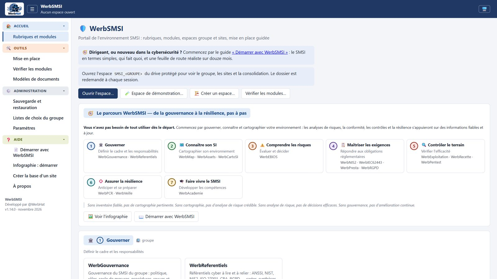

*Accueil du portail : le parcours en 7 étapes et les modules rangés par étape.*

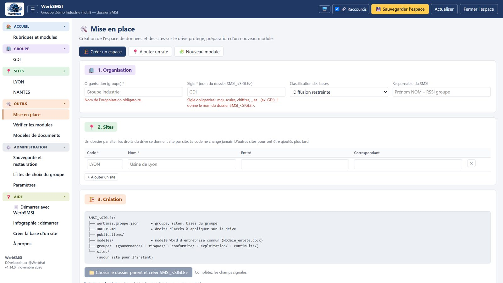

*🛠️ Outils › Mise en place : création de l'espace et des sites, sans aucune commande.*

---

## 3. Les étapes de mise en place

L'infographie **« Démarrer avec WerbSMSI »** (portail, ❓ Aide) résume le parcours en **7 étapes**. On n'utilise pas tout dès le départ : on commence par **gouverner** et **connaître** son système ; les analyses de risques, la conformité, les contrôles et la résilience s'appuient ensuite sur des informations fiables.

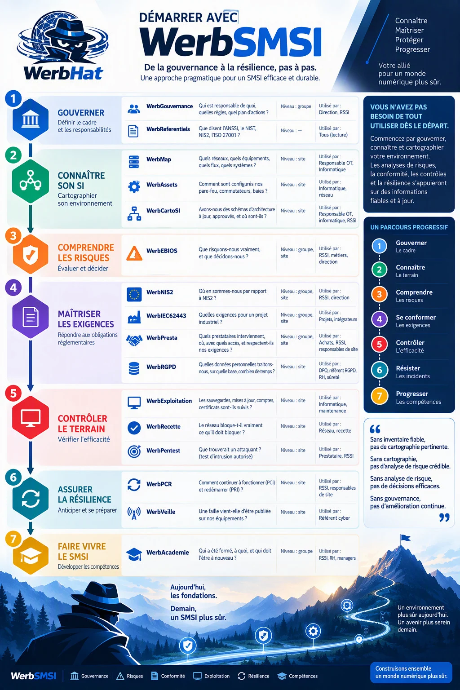

| Étape | Objectif | Modules | Niveau |
|---|---|---|---|
| 1. **Gouverner** | Définir le cadre et les responsabilités | WerbGouvernance, WerbReferentiels | groupe |
| 2. **Connaître son SI** | Cartographier son environnement | WerbMap, WerbAssets, WerbCartoSI | site |
| 3. **Comprendre les risques** | Évaluer et décider | WerbEBIOS | groupe et site |
| 4. **Maîtriser les exigences** | Répondre aux obligations | WerbNIS2, WerbIEC62443, WerbPresta, WerbRGPD | groupe et site |
| 5. **Contrôler le terrain** | Vérifier l'efficacité | WerbExploitation, WerbRecette, WerbPentest | site |
| 6. **Assurer la résilience** | Anticiper et se préparer | WerbPCR, WerbVeille | site |
| 7. **Faire vivre le SMSI** | Développer les compétences | WerbAcademie | groupe |

**L'ordre compte** : sans inventaire fiable, pas de cartographie pertinente ; sans cartographie, pas d'analyse de risques crédible ; sans analyse de risques, pas de décisions efficaces.

---

## 4. Sécuriser le dossier des données avec VeraCrypt

### Pourquoi

L'espace `SMSI_<SIGLE>` décrit **comment attaquer l'entreprise** : plan réseau, équipements et versions, vulnérabilités, accès à distance des prestataires, risques non traités. Les droits du dossier partagé ne suffisent pas : une copie du NAS, un poste volé, un compte cloud compromis exposent tout. La solution retenue : **ranger l'espace dans un conteneur chiffré VeraCrypt**.

### Le principe

```
 Dossier partagé (NAS ou cloud)            Poste du technicien
 ┌──────────────────────────────┐          ┌──────────────────────────────────────┐
 │  \\NAS\SMSI\                  │  lien    │  Raccourci « Conteneur SMSI »         │
 │   └─ SMSI_GDI.hc  (chiffré)   │◄─────────│                                      │
 │      ≈ 50 Mo, illisible       │          │  VeraCrypt : monter SMSI_GDI.hc → S: │
 └──────────────────────────────┘          │  S:\SMSI_GDI\  ← l'espace, en clair  │
                                            │                  le temps du travail │
 Kit WerbSMSI (programmes) : hors du        │  Edge : portail → Ouvrir l'espace S: │
 conteneur, sur le poste ou le partage      └──────────────────────────────────────┘
```

- Le **conteneur** est un seul fichier chiffré (AES), rangé sur le dossier partagé : sans le mot de passe, il est illisible.
- Il contient **uniquement l'espace** `SMSI_<SIGLE>` : bases JSON, publications, modèles Word. **Pas le kit WerbSMSI** (portail, modules, démonstration, guides) : il n'est pas confidentiel et alourdirait le conteneur.
- **Avant toute utilisation**, on **monte** le conteneur sur une lettre de lecteur fixe ; on ouvre ensuite l'espace depuis le portail. **Après**, on **démonte**.

### Taille

Un espace réel tient en quelques mégaoctets (l'espace de démonstration complet, avec ses modèles Word : moins de 1 Mo). Prévoir **50 Mo** plutôt que 10 : la marge couvre la croissance des bases, les modèles Word et les schémas de l'entreprise, pour un coût négligeable. Agrandir un conteneur existant est possible (outil *VeraCrypt Expander*) mais plus délicat.

### Créer le conteneur (une seule fois)

1. VeraCrypt › **Créer un volume** › *Créer un conteneur de fichiers chiffré* › **Volume VeraCrypt standard**.
2. **Emplacement** : le dossier partagé, par exemple `\\NAS\SMSI\SMSI_GDI.hc` (ou le dossier synchronisé du cloud).
3. **Chiffrement** : AES, hachage SHA-512 (valeurs par défaut).
4. **Taille** : 50 Mo.
5. **Mot de passe** : **20 caractères au moins**, généré et rangé dans le **coffre-fort de mots de passe** de l'entreprise, avec un second détenteur (RSSI). Sans lui, les données sont perdues.
6. **Système de fichiers** : NTFS. Bouger la souris pour l'aléa, puis **Formater**.
7. Monter le conteneur (ci-dessous), puis créer l'espace dedans avec le portail (*Mise en place*), ou y copier un espace existant.

### Régler VeraCrypt (une fois par poste)

| Réglage (*Paramètres › Préférences*) | Valeur | Pourquoi |
|---|---|---|
| **Conserver l'horodatage des conteneurs** | **décoché** | Sinon la date du fichier ne change pas après une modification : le client de synchronisation (Synology Drive, OneDrive…) **ne voit pas** le changement et n'envoie rien. |
| Démontage automatique à la fermeture de session | coché | Ne pas laisser l'espace en clair sur un poste quitté. |
| Démontage automatique après inactivité | 60 min, sans forcer | Sécurité, sans couper un enregistrement en cours. |
| Lettre de lecteur | **toujours la même** (par exemple `S:`) | Le portail et Windows retrouvent l'espace au même endroit ; épingler `S:\SMSI_GDI` dans l'Accès rapide. |

### Le cycle de travail

1. **Vérifier que personne d'autre n'a monté le conteneur** (voir la règle ci-dessous) et, sur un dossier synchronisé, que la **synchronisation est terminée** (icône à jour).
2. Ouvrir le **raccourci** du dossier partagé, puis VeraCrypt › **Sélectionner un fichier** `SMSI_GDI.hc` › lettre `S:` › **Monter** › mot de passe.
3. Ouvrir le **portail** › *Ouvrir l'espace…* › choisir `S:\SMSI_GDI`. Travailler normalement : ouvrir les bases depuis les puces, **enregistrer**.
4. **Fermer les modules** (le verrou de chaque base est libéré), puis VeraCrypt › **Démonter**.
5. Sur un dossier synchronisé : **attendre la fin de l'envoi** avant d'éteindre le poste.

### La règle d'or : un seul utilisateur à la fois

Un conteneur VeraCrypt ne peut être **monté en écriture que par un seul poste à la fois**.

- **Sur un NAS** (partage réseau) : un second montage est refusé tant que le premier est actif (« fichier en cours d'utilisation ») — c'est une protection.
- **Sur un dossier synchronisé** (cloud) : **rien n'empêche** deux personnes de monter chacune leur copie. Au retour, le client de synchronisation crée une **copie de conflit** et le travail de l'une des deux est perdu. Il faut donc une **convention** : prévenir l'équipe, ou poser un fichier `EN_COURS_<NOM>.txt` à côté du conteneur avant de monter, et le supprimer après le démontage.
- Le **verrou** des bases WerbSMSI (« 🔒 Ouvert par… ») protège à l'intérieur de l'espace monté ; il ne protège pas deux copies du conteneur.

### Sauvegarder

- **Le conteneur** : historique des versions du NAS ou du cloud activé (un conteneur abîmé se remplace par une version précédente).
- **L'espace** : *⚙️ Administration › Sauvegarde et restauration* du portail, **archive chiffrée AES-256** (portail 1.14.0), rangée ailleurs que le conteneur. Le mot de passe de l'archive va dans le coffre-fort.

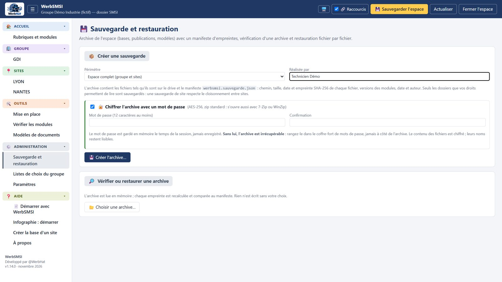

*Portail › Sauvegarde et restauration : archive chiffrée par mot de passe, proposée par défaut.*

---

## 5. Le portail

| Vue | À quoi elle sert |
|---|---|
| **Accueil** | Le parcours en 7 étapes, les modules et leur version, l'aide. |
| **Groupe** | Sites, conformité et risques par site, socle de mesures, **bases par module et par site** (une puce par site ouvre la base). |
| **Site** | Chiffres clés, bases déclarées avec leur **verrou** (« ouvert par… »), publications. |
| **🛠️ Mise en place** | Créer l'espace, ajouter un site. |
| **🛠️ Vérifier les modules** | Contrôle des empreintes SHA-256 : un module modifié est détecté. |
| **⚙️ Sauvegarde et restauration** | Archive de l'espace (chiffrée), vérification, restauration fichier par fichier. |
| **⚙️ Listes de choix du groupe** | Vocabulaire commun (types d'actif, périodicités…) publié pour tous les sites. |
| **⚙️ Paramètres** | Masquer les modules que l'organisation n'utilise pas. |

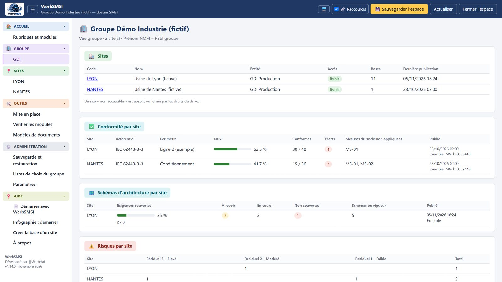

*Vue Groupe : conformité, risques et socle de mesures consolidés à partir des publications des sites.*

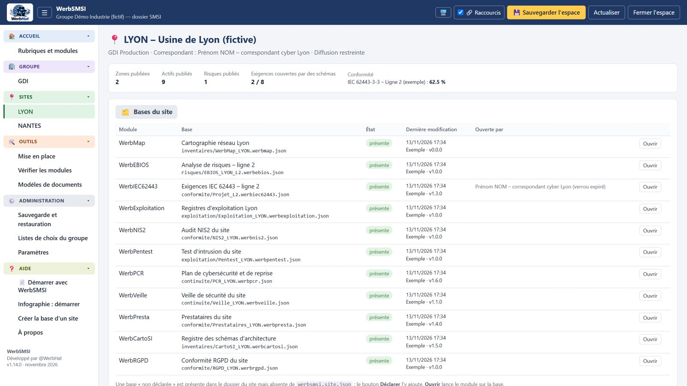

*Vue Site : les bases du site, leur version, leur dernier auteur et leur verrou.*

---

## 6. Les modules

Chaque module se présente de la même façon : un **bandeau** (utilisateur, site, verrou, Ouvrir, Enregistrer, exports), un **menu** à gauche, un **tableau de bord** avec ses **points d'attention**, et le menu **❓ Aide** avec le guide du module.

### Étape 1 — Gouverner

**WerbGouvernance** (groupe) — *Qui est responsable de quoi, quelles règles, quel plan d'actions ?* Politique et périmètre, rôles, **socle de mesures** exigé sur tous les sites, assistant PSSI, procédures, revues de direction, plan d'actions. Publie les **rôles** et le **socle**.

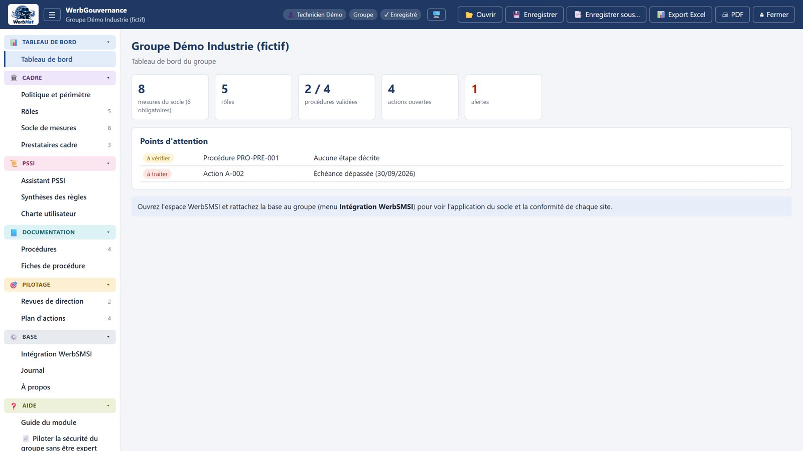

**WerbReferentiels** (lecture) — *Que disent l'ANSSI, le NIST, NIS2, l'ISO 27001, le CRA ?* Cartes et synthèses des référentiels, **tableau de correspondances** entre exigences. Aucune base, aucun échange.

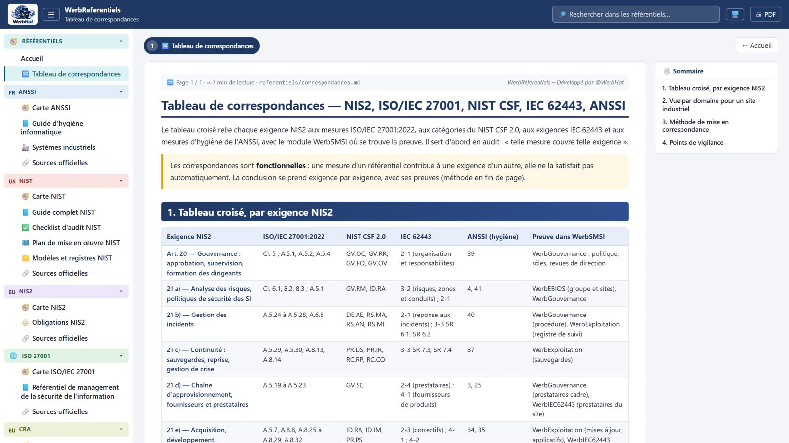

### Étape 2 — Connaître son SI

**WerbMap** (site) — *Quels réseaux, quels équipements, quels flux, quels systèmes ?* Matrice VLAN, plan IP, coffrets, actifs réseau, machines physiques et virtuelles, **liste des SI** et fiche SI, routes, NAT, **matrice de flux**, procédures. C'est le **référentiel du site** : le **TAG** d'un actif est la clé commune à tous les modules. Publie actifs, SI, zones, conduits, VLAN.

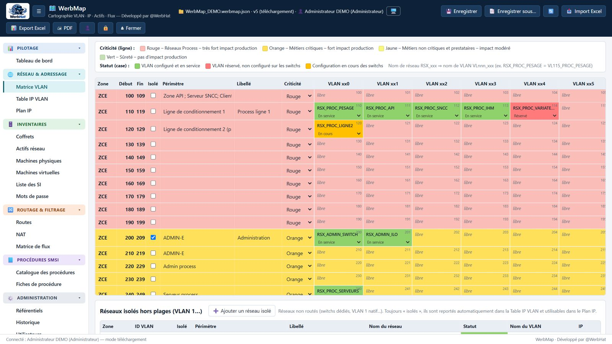

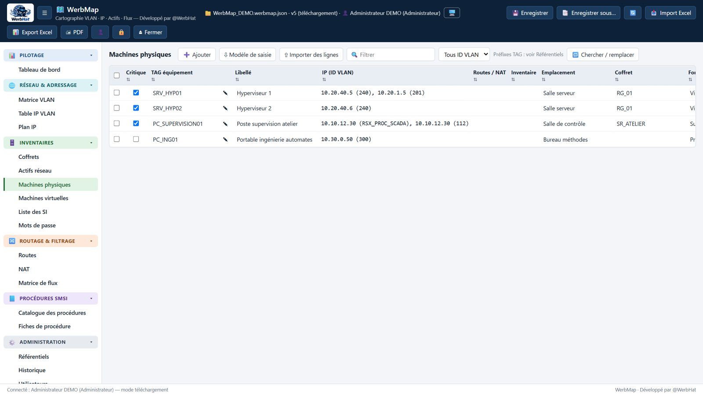

**WerbAssets** (site) — *Comment sont configurés nos pare-feu, commutateurs, baies ?* Fiches d'équipements, brassage, à partir des actifs de WerbMap.

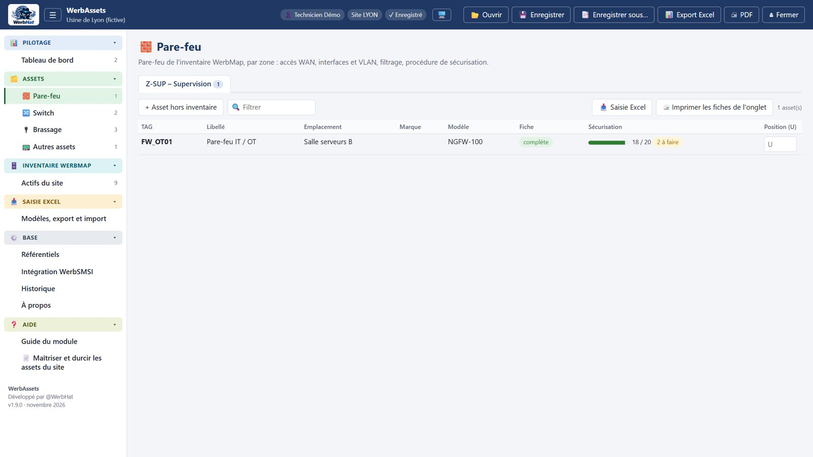

**WerbCartoSI** (site) — *Avons-nous des schémas d'architecture à jour, approuvés, et où sont-ils ?* Registre des schémas, couverture des exigences. Publie la couverture (preuve NIS2).

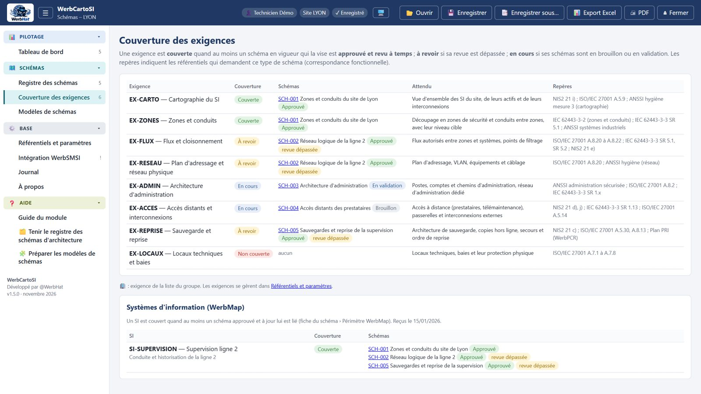

### Étape 3 — Comprendre les risques

**WerbEBIOS** (groupe et site) — *Que risquons-nous vraiment, et que décidons-nous ?* La méthode EBIOS Risk Manager en cinq ateliers. Le groupe fixe les **échelles**, les valeurs métier et les événements redoutés ; chaque site relie ses **biens supports** aux actifs de WerbMap, construit ses scénarios et décide du traitement. Publie la **synthèse des risques**.

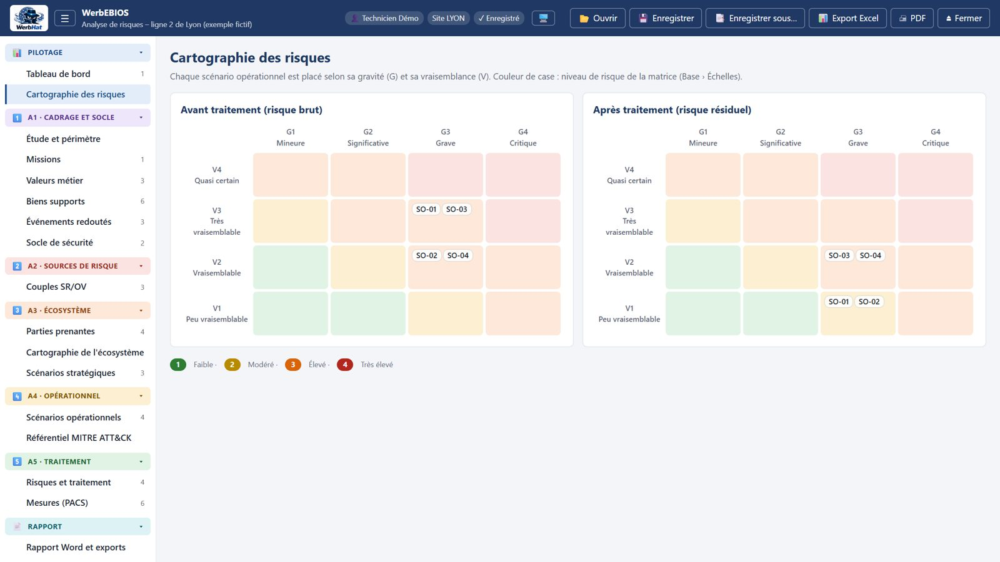

### Étape 4 — Maîtriser les exigences

**WerbNIS2** (groupe ou site) — *Où en sommes-nous par rapport à NIS2 ?* Grille d'audit (152 points), couverture par thématique, plan d'actions, rapport.

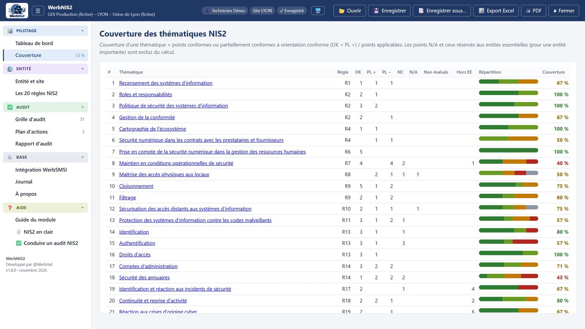

**WerbIEC62443** (site, projets) — *Quelles exigences pour un projet industriel ?* Zones et conduits, matrice d'allocation des exigences, plan, prestataires. Publie la **synthèse de conformité**.

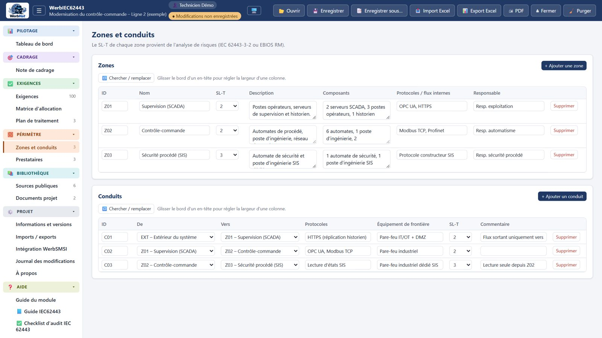

**WerbPresta** (groupe et site) — *Quels prestataires interviennent, avec quels accès, et respectent-ils nos exigences ?* Liste des prestataires, questionnaire et cahier d'exigences, écarts, couverture des actifs. Publie les **évaluations**.

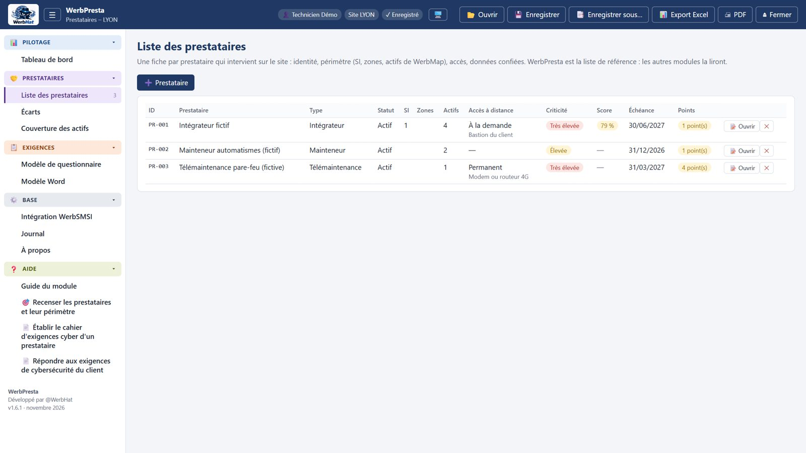

**WerbRGPD** (site) — *Quelles données personnelles traitons-nous ?* Registre des traitements, violations, demandes d'exercice des droits, sous-traitants.

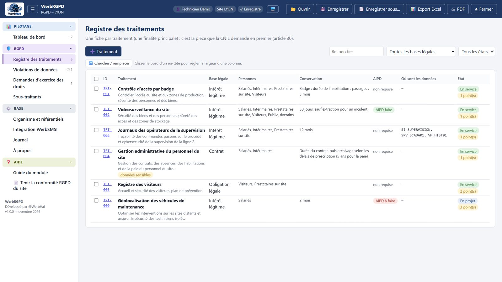

### Étape 5 — Contrôler le terrain

**WerbExploitation** (site) — *Les sauvegardes, mises à jour, comptes, certificats sont-ils suivis ?* Registre de suivi des tâches périodiques, parc et cycle de vie (inventaires de machines par script, référentiel logiciel), maintien en sécurité, comptes et accès, **sauvegardes**, changements, demandes de flux, interventions, licences. Publie sauvegardes, PLM, flux réalisés, inventaires.

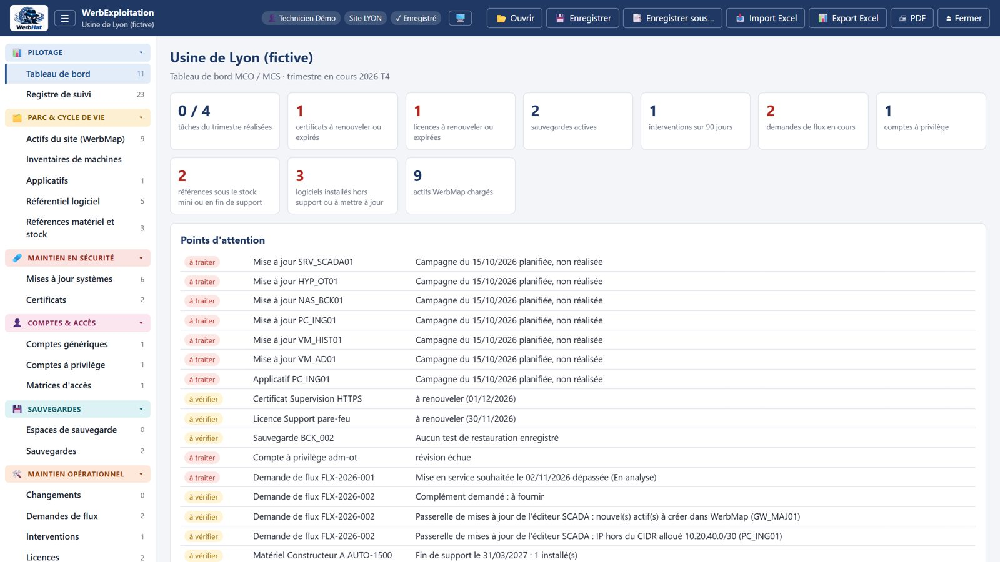

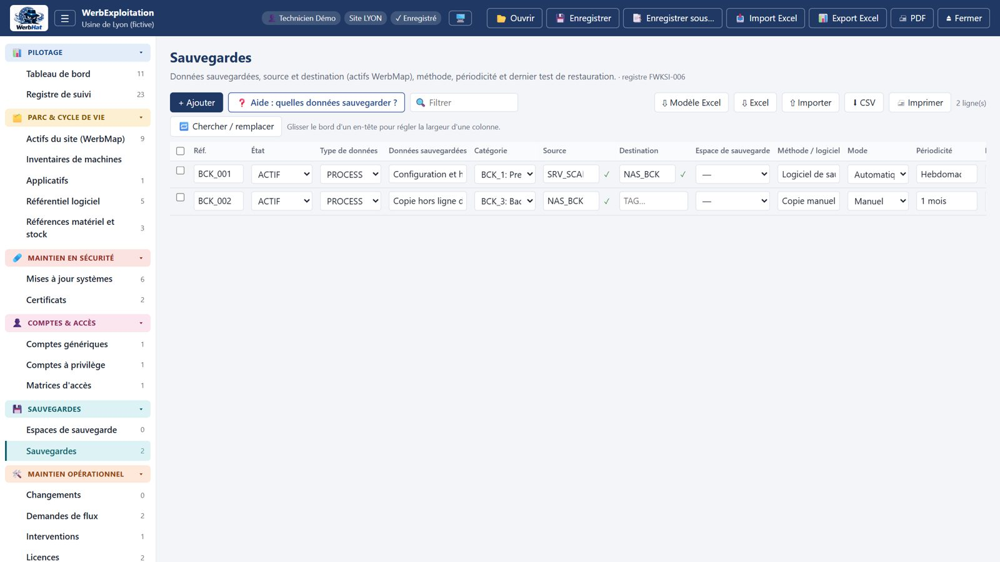

**WerbRecette** (site) — *Le réseau bloque-t-il vraiment ce qu'il doit bloquer ?* Tests réseau entre machines, campagnes, scripts et résultats.

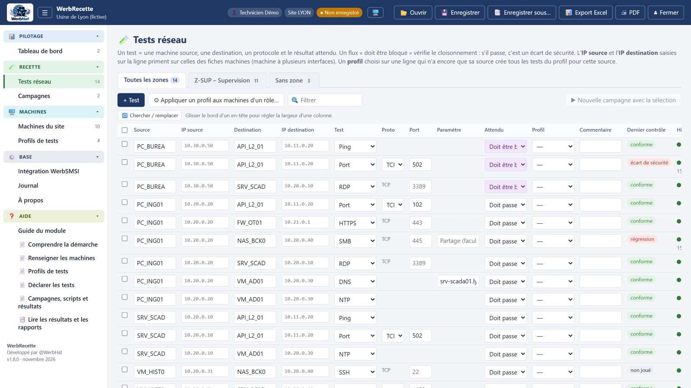

**WerbPentest** (site) — *Que trouverait un attaquant ?* Mandat, méthodologie, vulnérabilités (CVSS), plan de remédiation, rapport. Publie les **remédiations** par actif.

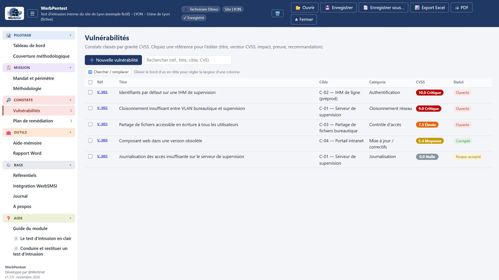

### Étape 6 — Assurer la résilience

**WerbPCR** (site) — *Comment continuer à fonctionner (PCI) et redémarrer (PRI) ?* Périmètre métier, fiches par SI, bilan d'impact, dépendances, ordre et procédures de reprise, contrôle des sauvegardes, document Word.

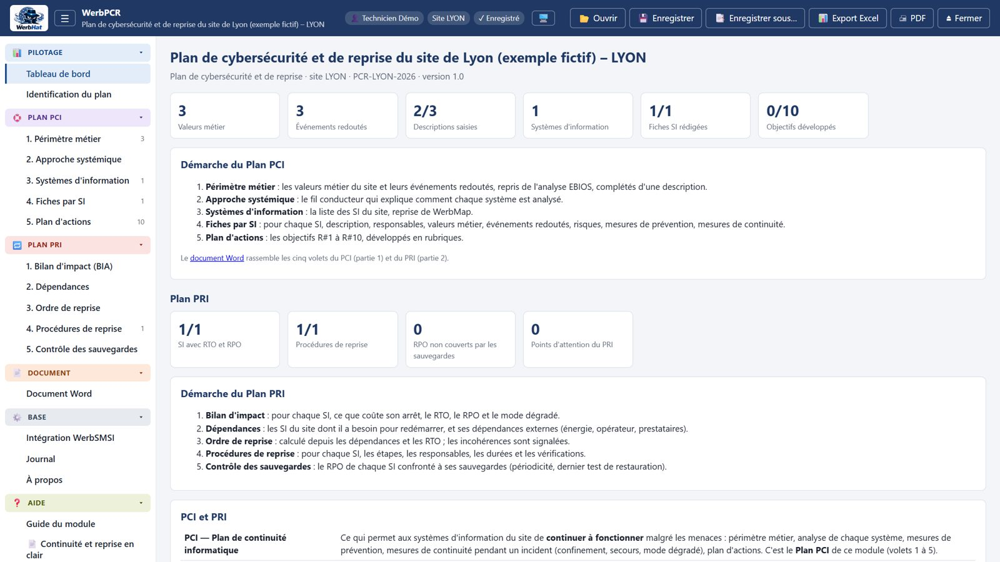

**WerbVeille** (site) — *Une faille vient-elle d'être publiée sur nos équipements ?* Sources, mots-clés, alertes, logiciels et CVE (NVD), kit de collecte sur un poste connecté.

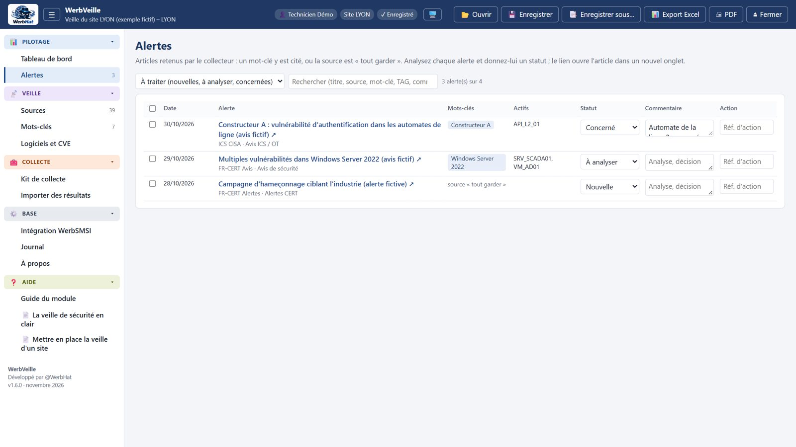

### Étape 7 — Faire vivre le SMSI

**WerbAcademie** (groupe) — *Qui a été formé, à quoi, et qui doit l'être à nouveau ?* Catalogue, sessions, personnes, suivi par population et par site. Publie les **indicateurs de formation**.

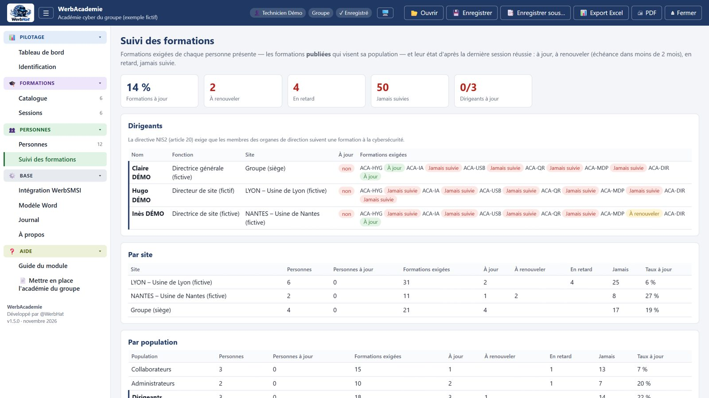

---

## 7. Les échanges entre modules

Les modules ne lisent **jamais** la base d'un autre module : chacun **publie** ce qu'il veut partager dans `publications/<module>.json`, et les autres modules **lisent ces publications** (copie en lecture seule, datée, sans donnée sensible). La cartographie complète est dans [Cartographie_echanges_WerbSMSI.pdf](../cartographie/Cartographie_echanges_WerbSMSI.pdf) (2 pages A4).

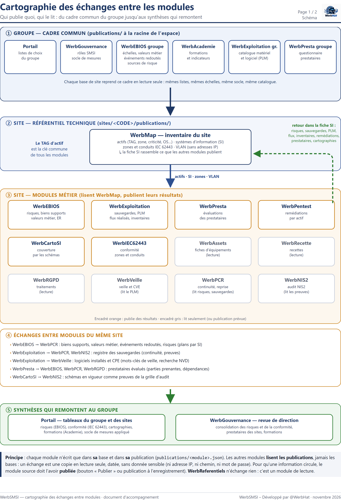

À retenir :

1. **Le groupe d'abord** : listes de choix (portail), rôles et socle (WerbGouvernance), échelles (WerbEBIOS groupe), catalogue (WerbExploitation groupe), questionnaire (WerbPresta groupe). Les sites les reprennent en lecture seule.
2. **WerbMap ensuite** : presque tous les modules de site lisent ses actifs, ses SI et ses zones.
3. **Les retours vers la fiche SI** de WerbMap : risques, sauvegardes, PLM, flux réalisés, inventaires, remédiations, prestataires, cartographies.
4. **Les synthèses remontent** au portail et à WerbGouvernance : risques, conformité, cartographies, formations.
5. **Pas de publication, pas d'échange** : après une modification importante, **republier** (page *Intégration WerbSMSI* du module).

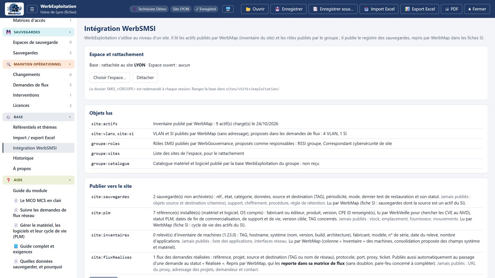

*Page « Intégration WerbSMSI » d'un module : ce qu'il lit, ce qu'il publie, et la date de chaque publication.*

---

## 8. Le travail au quotidien

| Geste | Comment |
|---|---|
| **Ouvrir une base** | Portail › vue Groupe ou Site › **puce** du site sous le module. Avec l'option 🔗 *Raccourcis*, la base s'ouvre directement. |
| **Verrou** | À l'ouverture, la base est verrouillée à votre nom (« 🔒 Ouvert par vous »). Si un collègue l'a ouverte : *Annuler*, *Ouvrir en lecture seule* ou *Prendre la main* (seulement s'il a quitté son poste). Un verrou expire après 12 heures. |
| **Enregistrer** | Bouton *Enregistrer* : la base est écrite à sa place, avec un **commentaire de version** (ce qui a changé). |
| **Publier** | Page *Intégration WerbSMSI* du module : met à jour ce que lisent les autres modules et le portail. |
| **Imprimer, exporter** | PDF, Excel, Word au modèle de l'entreprise (dossier `modeles/` de l'espace). |
| **Se faire aider** | Menu **❓ Aide** de chaque module : guide du module et guides d'accompagnement. |
| **Fermer** | Bouton *Fermer* : le verrou est libéré. Puis démonter le conteneur. |

---

## 9. Rythme et plan des 30 premiers jours

### Les 30 premiers jours

| Semaine | Objectif | Actions |
|---|---|---|
| **Semaine 1** | Installer et s'entraîner | Kit copié, modules vérifiés ; conteneur VeraCrypt créé et réglé ; parcours de l'**espace de démonstration** (portail, WerbMap, WerbExploitation) ; espace réel créé dans le conteneur ; première **sauvegarde chiffrée**. |
| **Semaine 2** | Poser le cadre | Rôles dans **WerbGouvernance** ; listes de choix du groupe ; échelles dans **WerbEBIOS groupe** ; académie dans **WerbAcademie** ; publications du groupe faites. |
| **Semaine 3** | Connaître le site | **WerbMap** : VLAN, plan d'adressage, équipements, flux, liste des SI ; coffre-fort de mots de passe organisé ; publication. |
| **Semaine 4** | Les registres essentiels | **WerbExploitation** : sauvegardes (et un test de restauration), comptes à privilège, mises à jour, inventaires par script ; **WerbPresta** : prestataires et accès à distance ; première revue avec le RSSI. |

### Le rythme de croisière

| Rythme | Activité | Module |
|---|---|---|
| Chaque semaine | Trier les alertes de veille ; vérifier que les sauvegardes ont tourné | WerbVeille, WerbExploitation |
| Chaque mois | Mises à jour, comptes, certificats ; avancement du plan d'actions ; nouveaux arrivants à former ; sauvegarde chiffrée de l'espace | WerbExploitation, WerbGouvernance, WerbAcademie, portail |
| Chaque trimestre | Comité cyber (risques, actions, incidents, formation) | Portail, WerbGouvernance, WerbAcademie |
| À chaque changement | Changement tracé, recette réseau, mise à jour de l'inventaire, nouveau prestataire évalué | WerbExploitation, WerbRecette, WerbMap, WerbPresta |
| Chaque année | Revue de direction, mise à jour EBIOS, test de restauration, test d'intrusion, exercice de reprise, audit NIS2 | WerbGouvernance, WerbEBIOS, WerbPentest, WerbPCR, WerbNIS2 |

---

## 10. Dépannage

| Symptôme | Cause probable | Que faire |
|---|---|---|
| Le portail ne trouve pas l'espace | Conteneur non monté, ou monté sur une autre lettre | Monter le conteneur sur la lettre habituelle (`S:`), puis *Ouvrir l'espace…* |
| VeraCrypt refuse le montage (« fichier en cours d'utilisation ») | Un collègue l'a monté (NAS) | Attendre qu'il démonte ; ne jamais copier le conteneur pour contourner. |
| Une « copie de conflit » du conteneur apparaît | Deux montages simultanés sur un dossier synchronisé | Ne monter aucune des deux ; avec le RSSI, monter chacune en lecture seule, comparer, garder la bonne, reporter les écarts. |
| Les modifications n'arrivent pas chez les collègues | Horodatage du conteneur conservé, ou synchronisation non terminée | Décocher *Conserver l'horodatage des conteneurs* ; attendre la fin de la synchronisation avant d'éteindre. |
| « Ouvert par … depuis … · lecture seule » | La base est verrouillée par un collègue | Lui demander de fermer ; *Prendre la main* seulement s'il a quitté son poste (sinon son travail serait écrasé). |
| Un module affiche des données d'un autre module anciennes | Publication non refaite | Republier depuis le module source (*Intégration WerbSMSI*). |
| *Vérifier les modules* signale une empreinte différente | Fichier du kit modifié ou abîmé | Ne pas l'utiliser ; recopier le kit d'origine. |
| Archive de sauvegarde : « Mot de passe incorrect » | Mauvais mot de passe | Le reprendre dans le coffre-fort ; sans lui, l'archive est irrécupérable. |
| Le bouton *Enregistrer* demande un dossier | Base ouverte sans raccourci d'espace | Choisir le dossier de l'espace (`S:\SMSI_GDI`) ; épingler ce dossier dans l'Accès rapide. |

---

## 11. Glossaire

| Terme | Définition |
|---|---|
| **Espace** | Le dossier `SMSI_<SIGLE>` qui contient toutes les données de l'organisation (groupe et sites). |
| **Base** | Le fichier JSON d'un module pour le groupe ou un site (par exemple `Exploitation_LYON.werbexploitation.json`). |
| **Publication** | Le fichier `publications/<module>.json` qu'un module écrit pour les autres ; seul moyen d'échange. |
| **TAG** | Identifiant unique d'un actif (par exemple `API_L2_01`), défini dans WerbMap et repris partout. |
| **SI** | Système d'information : un ensemble d'actifs qui rend un service (supervision, ligne 2…). |
| **Verrou** | Marque « ouvert par » posée dans une base ouverte, pour éviter d'écraser le travail d'un collègue. |
| **Conteneur VeraCrypt** | Fichier chiffré qui, une fois monté avec le mot de passe, apparaît comme un lecteur (`S:`). |
| **Monter / démonter** | Rendre le conteneur lisible sur une lettre de lecteur / le refermer. |
| **Empreinte SHA-256** | Signature d'un fichier : la moindre modification la change. |
| **Point d'attention** | Alerte du tableau de bord d'un module (échéance dépassée, information manquante…). |
| **MCO / MCS** | Maintien en condition opérationnelle / de sécurité (WerbExploitation). |
| **PCI / PRI** | Plan de continuité informatique / plan de reprise informatique (WerbPCR). |
| **RTO / RPO** | Durée d'arrêt acceptable / perte de données acceptable. |

> **En résumé** : monter le conteneur, ouvrir l'espace depuis le portail, ouvrir chaque base par sa puce, enregistrer, publier, fermer, démonter. Commencer par le groupe et WerbMap ; les autres modules s'appuient dessus.
