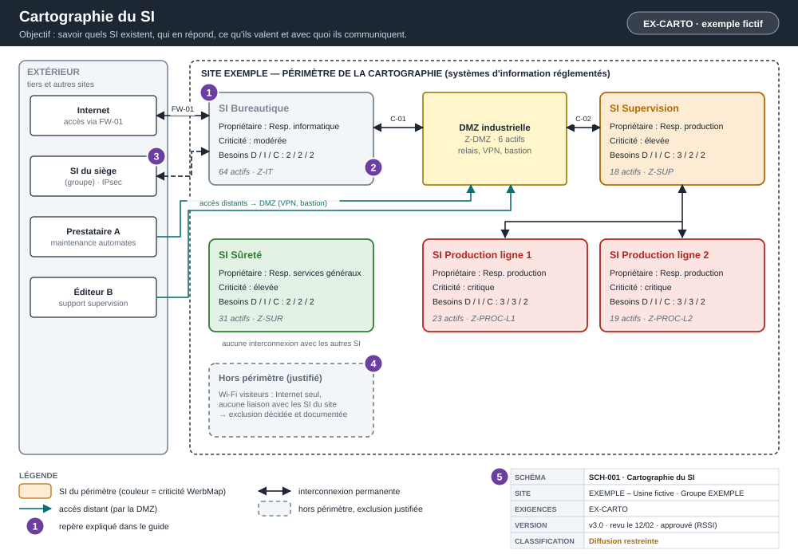
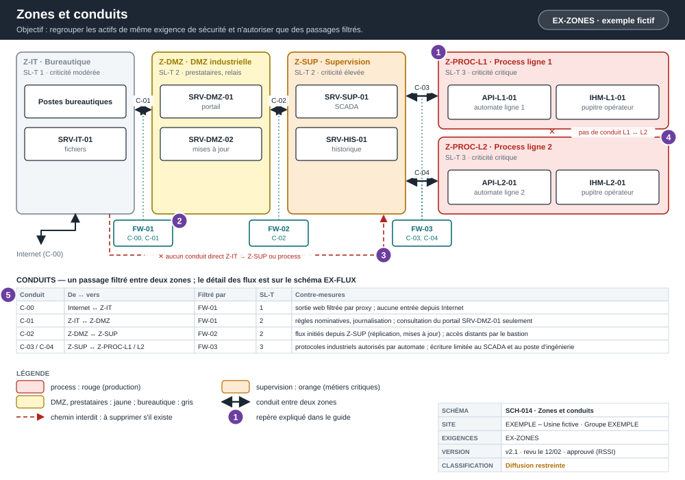
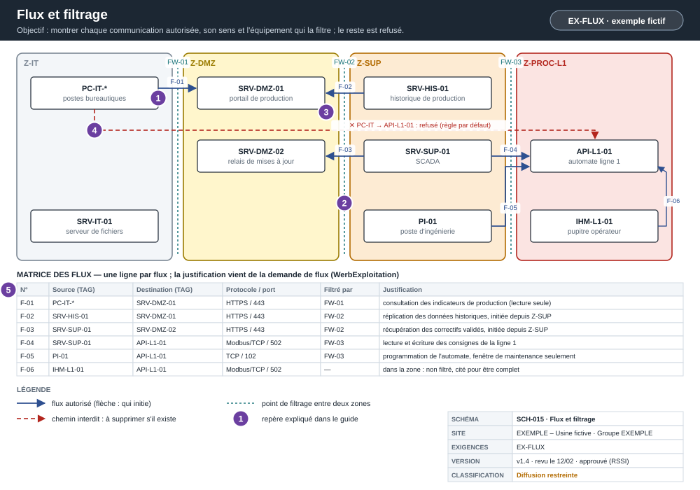
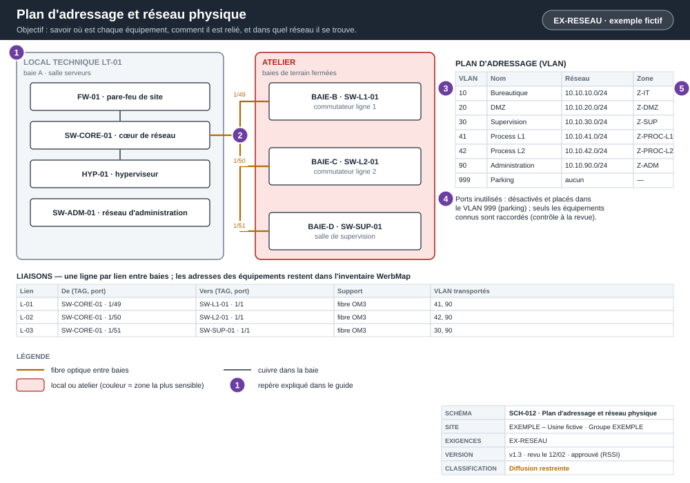
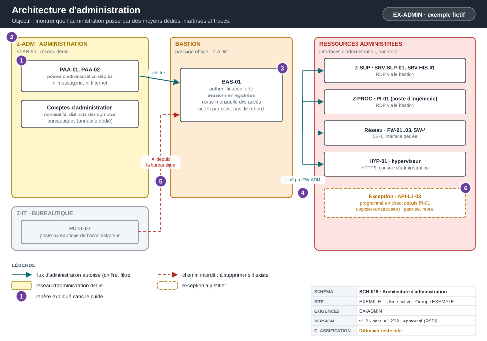
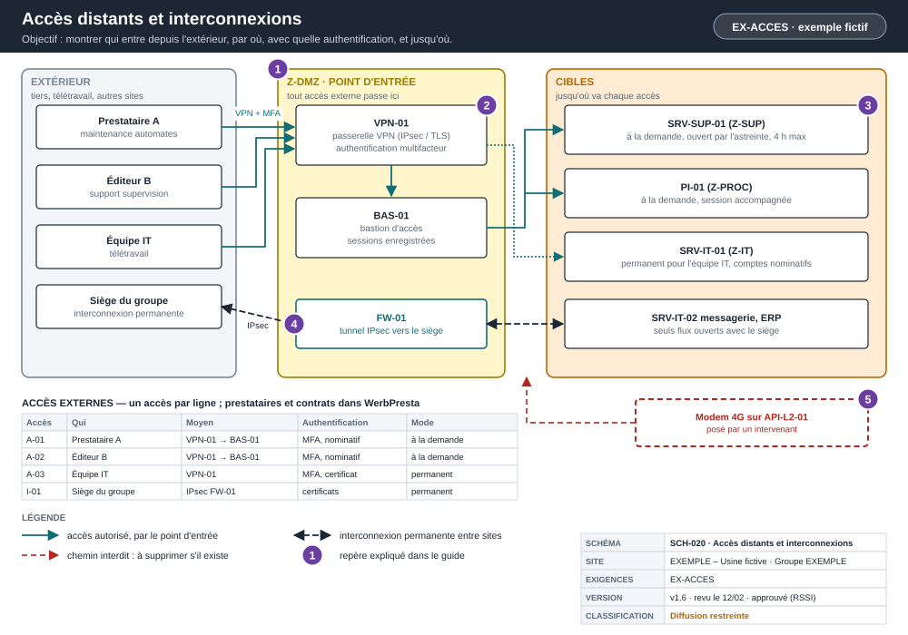
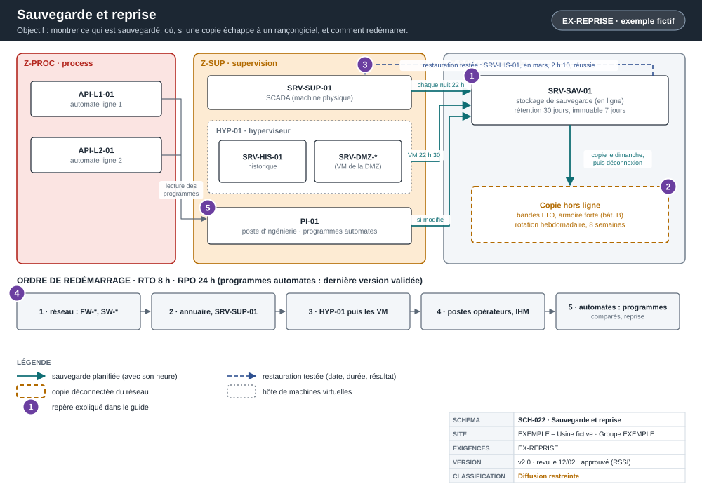
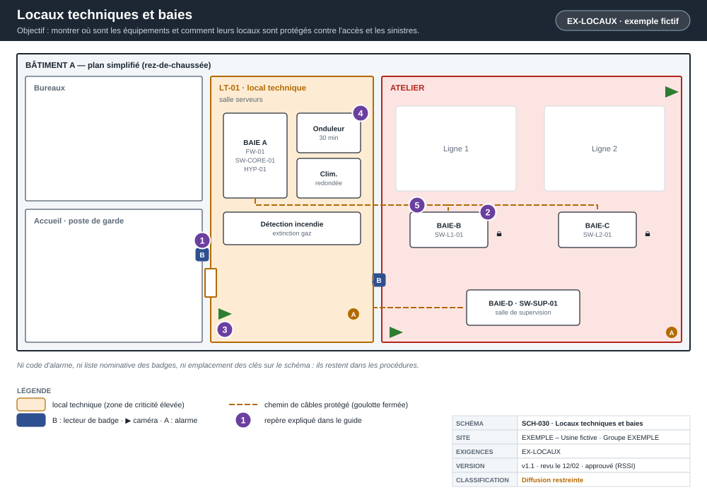

<!-- WerbCartoSI – Développé par @WerbHat -->
# Les schémas attendus, un par un

Un auditeur ne demande pas « un schéma » : il demande **la preuve** que le SI est connu, cloisonné, filtré, administré proprement, joignable de l'extérieur seulement par un chemin maîtrisé, et qu'il peut repartir après un sinistre. Chacune de ces preuves a son schéma. Ce guide les présente un par un : **à quoi sert le schéma, ce que l'auditeur y cherche, ce qu'il doit montrer, ce qu'il ne doit pas contenir**, et les exigences précises des référentiels qu'il aide à démontrer.

## 1. Lire les codes « EX- »

**EX = exigence.** `EX-ZONES` se lit « exigence : zones et conduits ». Les huit codes proposés sont des **catégories d'exigence** : ce qu'un schéma doit **démontrer**, quel que soit son dessin. Ce ne sont ni des exemples, ni des numéros de schéma (les schémas sont numérotés `SCH-001`, `SCH-002`…).

| Notion | Question à laquelle elle répond | Exemple |
|---|---|---|
| **Type de schéma** | Qu'est-ce que c'est ? (sa forme) | « Réseau physique (câblage, baies) » |
| **Catégorie d'exigence** (`EX-…`) | Qu'est-ce que ça prouve ? | `EX-RESEAU` et `EX-LOCAUX` |
| **Repères** | Quel texte le demande ? | NIS2 5.A.1-EI/EE, ISO/IEC 27001 A.7.12, guide d'hygiène de l'ANSSI mesure 4 |

Chaque catégorie est attendue soit **pour chaque SI**, soit **pour les SI sensibles**, soit **une fois pour le site** : c'est sa portée, qui règle la *couverture par SI* (guide [Tenir le registre des schémas](1-Tenir_le_registre_des_schemas.md), §6). Une catégorie qui ne concerne pas le site se déclare **non applicable**, avec sa justification : elle ne se laisse pas « non couverte ».

Les codes sont les mêmes dans tous les sites et dans les autres modules (WerbNIS2 les utilise pour proposer les schémas comme preuves). Un site peut ajouter ses propres catégories (*Référentiels et paramètres*), par exemple `EX-OT-SURETE` ; gardez alors le préfixe `EX-` pour qu'on les reconnaisse.

Le type le plus courant pour chaque catégorie :

| Type de schéma | Catégorie(s) qu'il couvre en général |
|---|---|
| Architecture générale du SI | `EX-CARTO` |
| Zones et conduits | `EX-ZONES` (et souvent `EX-CARTO`) |
| Flux | `EX-FLUX` |
| Réseau logique (VLAN, adressage) | `EX-RESEAU` |
| Réseau physique (câblage, baies) | `EX-RESEAU`, `EX-LOCAUX` |
| Architecture d'administration | `EX-ADMIN` |
| Accès distants et interconnexions | `EX-ACCES` |
| Sauvegarde et reprise | `EX-REPRISE` |
| Sûreté (vidéo, contrôle d'accès) | `EX-LOCAUX` |
| Architecture applicative | aucune par défaut : catégorie propre au site si besoin |

> Un schéma peut couvrir plusieurs catégories, mais un schéma qui veut tout montrer devient illisible et se périme vite. Six à huit planches tenues à jour valent mieux qu'un grand plan que personne n'ose modifier.

## 2. Lire les exemples

Chaque exemple est dessiné sur une **usine fictive** (« Site EXEMPLE ») : deux lignes de production, une supervision, une DMZ industrielle, une bureautique. Tous les noms, TAG, réseaux et dates sont inventés.

- Les **repères violets** ① ② ③… renvoient à la liste « Ce que montre l'exemple » sous chaque image.
- Les **couleurs des zones** sont celles de WerbMap : rouge pour le process, orange pour les métiers critiques, jaune pour la DMZ et les prestataires, vert pour la sûreté, gris pour la bureautique.
- En **sarcelle** : ce qui filtre ou autorise. En **rouge pointillé** : ce qui est **interdit** ; s'il existe sur le site, on le supprime, on ne le documente pas comme normal.
- Chaque planche porte son **cartouche** (identifiant, version, date de revue, approbation, classification).

Cliquez sur une image pour l'agrandir.

**Par où commencer ?** Dans cet ordre, chaque schéma s'appuie sur le précédent : cartographie, zones et conduits, flux, accès distants, administration, sauvegarde et reprise, puis plan d'adressage et locaux.

## 3. EX-CARTO — Cartographie du SI

**Objectif.** Savoir quels systèmes d'information existent sur le site, qui en répond, ce qu'ils valent, et avec quoi ils communiquent. C'est le premier schéma demandé : sans lui, aucun autre ne se comprend.

**Questions de l'auditeur.** Quels SI sont dans le périmètre, et lesquels en sont exclus, pourquoi ? Qui est responsable de chacun ? Lesquels sont critiques ? Quelles liaisons sortent du site ?

**Ce que montre l'exemple**

1. Chaque **SI** est nommé, avec son **propriétaire** (une fonction, pas une personne), sa **criticité** et ses **besoins** de disponibilité, d'intégrité et de confidentialité (repris de la fiche SI de WerbMap).
2. Le **nombre d'actifs** et la zone renvoient à l'**inventaire** : la cartographie ne recopie pas la liste des équipements, elle dit où la trouver.
3. Chaque **interconnexion**, interne ou externe, apparaît avec son moyen : pare-feu, tunnel, DMZ, accès distant.
4. Un SI **exclu du périmètre** (ici le Wi-Fi visiteurs) est montré avec sa justification : l'exclusion est une décision, pas un oubli.
5. Le **cartouche** dit quelle version on regarde, quand elle a été revue et qui l'a approuvée.

**À ne pas y mettre.** Le détail des équipements, des adresses et des règles : ils ont leurs propres schémas. Une cartographie trop détaillée n'est jamais à jour.

**Repères**

| Référentiel | Exigence |
|---|---|
| NIS2 | Objectif 1, 1.1 à 1.3 (recenser les SI, exclusions justifiées) ; objectif 5, **5.A.1-EI/EE** (cartographie à jour, assez détaillée pour le maintien en condition de sécurité et la gestion d'incident) |
| Directive (UE) 2022/2555 | Art. 21 §2 i) : gestion des actifs |
| ISO/IEC 27001:2022 | A.5.9 : inventaire des informations et autres actifs associés |
| IEC 62443 | 62443-3-2 ZCR 1 : identification du système étudié ; 62443-3-3 SR 7.8 : inventaire des composants |
| ANSSI, guide d'hygiène | Mesure 4 : identifier les informations et serveurs sensibles et maintenir un schéma du réseau |

## 4. EX-ZONES — Zones et conduits

**Objectif.** Regrouper les actifs qui ont les mêmes exigences de sécurité dans des **zones**, et n'autoriser entre elles que des **conduits** identifiés et filtrés. Une compromission de la bureautique ne doit pas atteindre le process.

**Questions de l'auditeur.** Comment le réseau est-il découpé ? Quel niveau de sécurité vise chaque zone ? Par où passe-t-on d'une zone à l'autre, et qui filtre ? Existe-t-il un passage direct entre la bureautique et le process ?

**Ce que montre l'exemple**

1. Chaque **zone** a un identifiant (Z-PROC-L1), sa **criticité** (couleur) et son **niveau de sécurité cible** (SL-T, IEC 62443).
2. Chaque **conduit** est numéroté (C-01…) et **filtré par un équipement nommé** (FW-01…).
3. **Aucun conduit direct** entre la bureautique et la supervision ou le process : tout passe par la DMZ industrielle.
4. Les **sous-systèmes** (lignes 1 et 2) sont cloisonnés **entre eux** : un incident sur une ligne ne se propage pas à l'autre.
5. Le **tableau des conduits** donne, pour chacun, les zones reliées, l'équipement, le SL-T et les contre-mesures.

**À ne pas y mettre.** Les règles de pare-feu détaillées (elles vont sur le schéma des flux et dans la configuration), les adresses IP.

**Repères**

| Référentiel | Exigence |
|---|---|
| NIS2 | Objectif 7, **7.A.1-EI/EE à 7.A.4-EE** : SI cloisonnés entre eux et vis-à-vis des tiers ; sous-systèmes étudiés, justifiés et cloisonnés |
| IEC 62443 | 62443-3-2 **ZCR 3** : découpage en zones et conduits ; SL-T fixé par l'évaluation détaillée des risques (ZCR 5) ; 62443-3-3 SR 5.1 (segmentation du réseau), SR 5.2 (protection des frontières de zone) |
| ISO/IEC 27001:2022 | A.8.22 : cloisonnement des réseaux |
| ANSSI | Guide d'hygiène, mesure 19 : segmenter le réseau et cloisonner les zones ; « La cybersécurité des systèmes industriels » (classes de cybersécurité) |

## 5. EX-FLUX — Flux et filtrage

**Objectif.** Montrer **chaque communication autorisée** : qui parle à qui, avec quel protocole, dans quel sens, et quel équipement la filtre. Tout ce qui n'est pas sur le schéma est refusé.

**Questions de l'auditeur.** Les flux entre zones sont-ils définis et documentés ? Qui a demandé chaque ouverture, et pourquoi ? Que se passe-t-il pour un flux non prévu ?

**Ce que montre l'exemple**

1. Chaque **flux** a un numéro, une **source**, une **destination** (TAG), un **protocole et un port**, et un **sens** : la flèche part de celui qui initie la connexion.
2. Chaque passage d'une zone à l'autre traverse un **point de filtrage** nommé.
3. Les flux entre la bureautique et la supervision **s'arrêtent en DMZ** (F-01 et F-02 aboutissent à SRV-DMZ-01) : aucun flux ne traverse directement de la bureautique au process.
4. Un **flux interdit** est montré barré : il est refusé par la règle par défaut. C'est la preuve que le filtrage fonctionne en « tout ce qui n'est pas autorisé est interdit ».
5. La **matrice des flux** porte la **justification** de chaque flux ; elle vient de la demande de flux (WerbExploitation) et correspond à la matrice de WerbMap.

**À ne pas y mettre.** Les comptes de service, les mots de passe, les clés de chiffrement ; les adresses publiques.

**Repères**

| Référentiel | Exigence |
|---|---|
| NIS2 | Objectif 7, **7.B.1-EI/EE et 7.B.2-EE** : communications nécessaires définies et documentées ; 7.A.7-EI/EE et 7.A.8-EE : seules les interconnexions nécessaires |
| ISO/IEC 27001:2022 | A.8.20 (sécurité des réseaux), A.8.21 (sécurité des services réseau), A.8.22 (cloisonnement des réseaux) |
| IEC 62443-3-3 | SR 5.1, SR 5.2 (protection des frontières de zone, refus par défaut) |
| ANSSI, guide d'hygiène | Mesures 19 (cloisonnement), 22 (passerelle d'accès sécurisé à Internet), 23 (cloisonner les services visibles depuis Internet) |

## 6. EX-RESEAU — Plan d'adressage et réseau physique

**Objectif.** Savoir **où** se trouve chaque équipement réseau, **comment** il est relié, et **dans quel réseau** (VLAN) se trouve chaque zone. C'est le schéma qu'on ouvre en premier pendant une panne ou un incident.

**Questions de l'auditeur.** Le plan d'adressage est-il tenu ? Les VLAN correspondent-ils aux zones ? Peut-on brancher n'importe quel équipement sur une prise libre ?

**Ce que montre l'exemple**

1. Chaque équipement est rangé dans sa **baie** et son **local** (le local technique, l'atelier).
2. Les **liens physiques** entre baies portent leur support (fibre, cuivre) et leurs **ports**.
3. Le **plan d'adressage** : un VLAN par zone, avec son identifiant, son nom, son réseau et sa zone.
4. Les **ports inutilisés** sont désactivés et placés dans un VLAN sans réseau : seuls les équipements connus sont raccordés.
5. Le plan d'adressage est celui que WerbMap publie (`site:vlans`) : le schéma le représente, il ne le remplace pas.

**À ne pas y mettre.** Les communautés SNMP, les mots de passe des équipements, les configurations complètes. Les adresses de chaque machine restent dans l'inventaire.

**Repères**

| Référentiel | Exigence |
|---|---|
| NIS2 | 5.A.1-EI/EE : ressources matérielles et interconnexions identifiables |
| ISO/IEC 27001:2022 | A.8.20 (sécurité des réseaux), A.7.12 (sécurité du câblage), A.5.9 (inventaire) |
| IEC 62443-3-3 | SR 7.8 : inventaire des composants |
| ANSSI, guide d'hygiène | Mesures 4 (schéma du réseau) et 7 (n'autoriser la connexion qu'aux équipements maîtrisés) |

## 7. EX-ADMIN — Architecture d'administration

**Objectif.** Montrer que l'administration du SI passe par des **moyens dédiés**, maîtrisés et tracés. Un attaquant qui prend un poste d'administrateur prend tout le SI : c'est la cible prioritaire.

**Questions de l'auditeur.** D'où administre-t-on ? Les postes et les comptes d'administration sont-ils séparés de la bureautique ? Les actions sont-elles tracées ? Peut-on administrer un serveur depuis son poste de messagerie ?

**Ce que montre l'exemple**

1. Des **postes d'administration dédiés**, sans messagerie ni accès à Internet, et des **comptes d'administration** nominatifs, distincts des comptes bureautiques.
2. Un **réseau d'administration dédié** (ici le VLAN 90) : les interfaces d'administration n'y sont joignables que depuis ce réseau.
3. Un **bastion**, passage obligé : authentification forte, sessions enregistrées, revue des accès.
4. Les flux d'administration sont **filtrés** vers chaque zone : le réseau d'administration ne crée pas de chemin que le cloisonnement interdit.
5. L'administration **depuis la bureautique est interdite** : c'est le chemin le plus utilisé par les attaquants.
6. Une **exception** (un automate programmé en direct avec le logiciel du constructeur) est montrée, justifiée et revue : on ne la cache pas.

**À ne pas y mettre.** La liste des comptes et de leurs droits (registre à part), les mots de passe, l'emplacement des secrets.

**Repères**

| Référentiel | Exigence |
|---|---|
| NIS2 | Objectif 11, 11.A (comptes d'administration) ; objectif 19 (entités essentielles), **19.1-EE** (réseau d'administration dédié), **19.7-EE** (liaison physique dédiée), **19.8-EE** (cloisonnement et filtrage respectés) |
| ISO/IEC 27001:2022 | A.8.2 (droits d'accès à privilèges), A.8.5 (authentification sécurisée), A.8.15 (journalisation) |
| IEC 62443-3-3 | SR 1.1 (identification et authentification des utilisateurs humains), SR 2.1 (application des autorisations), SR 2.8 (événements journalisés) |
| ANSSI | Guide d'hygiène, mesures 27 (pas d'Internet depuis les postes d'administration), 28 (réseau d'administration dédié et cloisonné), 29 (droits d'administration limités) ; recommandations relatives à l'administration sécurisée des SI |

## 8. EX-ACCES — Accès distants et interconnexions

**Objectif.** Montrer **qui** entre dans le SI depuis l'extérieur (prestataires, éditeurs, télétravail, autres sites), **par où**, avec **quelle authentification**, et **jusqu'où**. Les accès des tiers sont l'une des premières portes d'entrée des attaques.

**Questions de l'auditeur.** Combien de chemins mènent de l'extérieur au SI ? Sont-ils tous chiffrés et protégés par une authentification multifacteur ? Un prestataire peut-il se connecter quand il veut, à tout ? Avez-vous recherché les accès « oubliés » (modem, prise en main à distance installée par un intervenant) ?

**Ce que montre l'exemple**

1. Un **point d'entrée unique** en DMZ : tout accès externe y passe.
2. Une **passerelle VPN** avec **authentification multifacteur** et un chiffrement conforme aux recommandations de l'ANSSI.
3. Chaque accès va **jusqu'à une cible précise**, à la demande et pour une durée limitée quand c'est un tiers ; les sessions passent par le bastion et sont enregistrées.
4. L'**interconnexion** avec le siège est permanente mais limitée aux flux nécessaires (messagerie, ERP).
5. Un **accès interdit** trouvé sur le site (un modem 4G posé sur un automate) est montré pour être **retiré** : il contourne toutes les protections.

**À ne pas y mettre.** Les adresses publiques, les identifiants des prestataires, les clés ou certificats. Les contrats et interlocuteurs restent dans WerbPresta.

**Repères**

| Référentiel | Exigence |
|---|---|
| NIS2 | Objectif 8, **8.1-EI/EE** (accès à travers un SI tiers protégés par un chiffrement conforme aux recommandations de l'ANSSI) ; objectif 3, 3.A.1-EI/EE (cartographie de l'écosystème : prestataires, accès) ; 7.A.7-EI/EE et 7.A.8-EE |
| Directive (UE) 2022/2555 | Art. 21 §2 d) (sécurité de la chaîne d'approvisionnement) et j) (authentification multifacteur, communications sécurisées) |
| ISO/IEC 27001:2022 | A.5.19 à A.5.22 (relations avec les fournisseurs), A.6.7 (travail à distance), A.5.14 (transfert de l'information) |
| IEC 62443-3-3 | SR 1.13 (accès via des réseaux non sûrs), SR 5.2 (protection des frontières de zone) |
| ANSSI, guide d'hygiène | Mesure 25 : sécuriser les interconnexions réseau dédiées avec les partenaires |

## 9. EX-REPRISE — Sauvegarde et reprise

**Objectif.** Montrer **ce qui est sauvegardé**, **où**, si **une copie échappe à un rançongiciel**, si la **restauration a été testée**, et **dans quel ordre** redémarrer. Le jour d'une attaque, c'est ce schéma qui guide la reprise.

**Questions de l'auditeur.** Qu'est-ce qui est sauvegardé, et à quelle fréquence ? Une copie est-elle hors ligne ? Quand avez-vous restauré pour la dernière fois, et combien de temps cela a-t-il pris ? Dans quel ordre redémarrez-vous, et en combien de temps ?

**Ce que montre l'exemple**

1. Les **flux de sauvegarde**, chacun avec sa **fréquence et son heure**, vers un stockage dont la rétention est indiquée.
2. Une **copie hors ligne** (support déconnecté, rangé dans un autre bâtiment) : c'est elle qui permet de repartir après un rançongiciel.
3. Le **dernier test de restauration réel** : ce qui a été restauré, quand, en combien de temps, avec quel résultat.
4. L'**ordre de redémarrage**, avec la durée maximale d'interruption admissible (RTO) et la perte de données maximale admissible (RPO).
5. Les **programmes des automates** sont sauvegardés à chaque modification : sans eux, un automate remplacé ne redémarre pas.

**À ne pas y mettre.** Le code d'accès de l'armoire forte, les mots de passe de chiffrement des sauvegardes, les procédures détaillées.

> Le schéma prouve la **conception**. La preuve que les sauvegardes tournent et que la restauration est testée reste le **registre des sauvegardes** de WerbExploitation.

**Repères**

| Référentiel | Exigence |
|---|---|
| NIS2 | Objectif 13, **13.1-EI/EE** (procédures de sauvegarde et de restauration), **13.2-EI/EE** (tests au moins une fois par an), **13.3-EI/EE** (sauvegardes protégées, par exemple hors ligne), **13.6-EE** (PCA et PRA, entités essentielles) |
| Directive (UE) 2022/2555 | Art. 21 §2 c) : continuité des activités, gestion des sauvegardes, reprise |
| ISO/IEC 27001:2022 | A.8.13 (sauvegarde des informations), A.5.30 (préparation des TIC pour la continuité), A.8.14 (redondance) |
| IEC 62443-3-3 | SR 7.3 (sauvegarde du système), SR 7.4 (restauration et reconstitution) |
| ANSSI, guide d'hygiène | Mesure 37 : politique de sauvegarde des composants critiques |

## 10. EX-LOCAUX — Locaux techniques et baies

**Objectif.** Montrer **où** sont les équipements et **comment leurs locaux sont protégés** : contre l'accès non autorisé (badge, serrure, caméra, alarme) et contre les sinistres (alimentation, climatisation, incendie).

**Questions de l'auditeur.** Qui peut entrer dans la salle serveurs ? Les baies de l'atelier sont-elles fermées ? Les accès sont-ils surveillés ? Que se passe-t-il en cas de coupure de courant ou de surchauffe ?

**Ce que montre l'exemple**

1. La **salle serveurs** est fermée et son accès contrôlé par **badge**.
2. Les **baies de terrain** de l'atelier sont **fermées à clé**.
3. **Caméras** et **alarme** couvrent les accès des locaux techniques, reliées au poste de garde.
4. L'**alimentation secourue** (onduleur, avec son autonomie), la **climatisation** et la **détection incendie** du local technique.
5. Les **câbles** entre le local technique et les baies passent dans un **chemin protégé**.

**À ne pas y mettre.** Les codes d'alarme, la liste nominative des badges, l'emplacement des clés : ils restent dans les procédures de sûreté.

**Repères**

| Référentiel | Exigence |
|---|---|
| NIS2 | Objectif 6, **6.2-EE** (entités essentielles) : protection physique des locaux, salles serveurs et locaux techniques (vidéosurveillance, gardiennage, alarme) |
| Directive (UE) 2022/2555 | Art. 21 §2 : approche « tous risques », qui couvre l'environnement physique des SI |
| ISO/IEC 27001:2022 | A.7.1 à A.7.4 (périmètres, entrées, bureaux et salles, surveillance), A.7.5 (menaces physiques et environnementales), A.7.8 (emplacement du matériel), A.7.11 (services généraux), A.7.12 (câblage) |
| ANSSI, guide d'hygiène | Mesure 26 : contrôler et protéger l'accès aux salles serveurs et aux locaux techniques |

## 11. Avant d'approuver un schéma

- [ ] Le **cartouche** est rempli : identifiant, version, date, propriétaire, **classification**.
- [ ] La **légende** explique chaque couleur et chaque type de trait.
- [ ] Les équipements sont désignés par leur **TAG** de WerbMap, les zones par leur identifiant.
- [ ] Les chemins **interdits** trouvés sur le site sont signalés pour être supprimés, pas dessinés comme normaux.
- [ ] Les **exceptions** sont visibles et justifiées.
- [ ] **Aucun secret** : ni mot de passe, ni clé, ni code d'accès, ni adresse publique.
- [ ] Le schéma a été **comparé au terrain** (ou à l'inventaire) lors de cette revue.
- [ ] Les **exigences** cochées dans la fiche sont bien celles que le schéma démontre (voir les objectifs ci-dessus).

Les modèles Visio fournis pour EX-ZONES, EX-ACCES, EX-ADMIN et EX-REPRISE reprennent ces conventions : voir [Préparer les modèles de schémas](2-Preparer_les_modeles_de_schemas.md).

> **À propos des repères.** Ils indiquent les exigences que le schéma aide à démontrer, pas une équivalence officielle entre référentiels. Les codes NIS2 (5.A.1-EI/EE, 7.A.1-EI/EE…) sont les identifiants des moyens acceptables de conformité du référentiel NIS2, repris par WerbNIS2 1.12.0 ; le suffixe indique si la mesure est attendue d'une entité importante et essentielle (EI/EE) ou des seules entités essentielles (EE). Les numéros de mesures de l'ANSSI sont ceux du guide d'hygiène informatique (version 2.0, 42 mesures).
