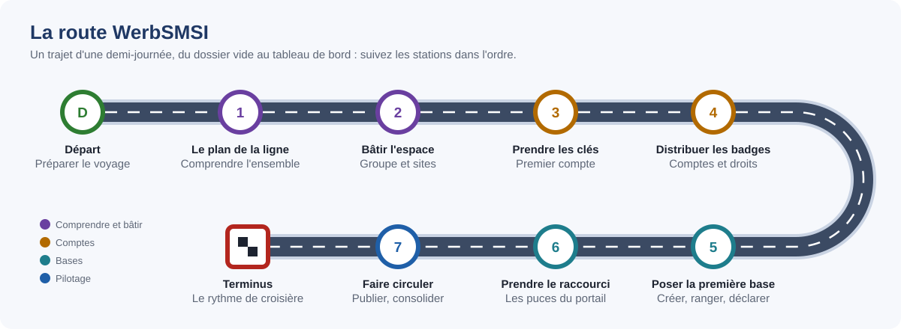

<!-- WerbSMSI – Développé par @WerbHat : premiers pas, du dossier vide au tableau de bord -->
# En route avec WerbSMSI — vos premiers pas, station par station

Bienvenue à bord. Ce guide vous emmène **du dossier vide au premier tableau de bord**, en une demi-journée environ. La route compte un départ, sept stations et un terminus : à chaque station, un geste à faire, la personne qui le fait et un **billet à composter** (une petite liste à cocher) avant de repartir.



> **Vous découvrez WerbSMSI ?** Faites d'abord le trajet dans l'**espace de démonstration** livré avec WerbSMSI (`demo/SMSI_GROUPE_DEMO`) : le portail le propose à l'ouverture, et ses comptes sont tout prêts (`admin.demo` / `Demo-Admin-2026`). Rien de ce que vous y faites ne touche vos vraies données. Pour le contexte (ce qu'est un SMSI, qui fait quoi, la feuille de route sur douze mois), lisez [Démarrer avec WerbSMSI](1-Demarrer_avec_WerbSMSI.md).

---

## 🚉 Départ — Préparer le voyage

⏱ 10 minutes · 👤 l'équipe SMSI du groupe et la personne qui gère le drive

Trois choses dans le sac avant de partir :

- **Microsoft Edge** sur chaque poste. WerbSMSI écrit directement dans les dossiers du drive : Edge (ou Chrome) le permet, Firefox non (il télécharge les fichiers, qu'il faut ensuite déplacer à la main).
- **Un drive protégé** (SharePoint synchronisé, partage réseau) où ranger l'espace, avec la possibilité de régler les droits **par dossier**.
- **Le dossier WerbSMSI** (le portail et les modules), accessible aux utilisateurs : sur le drive ou copié sur les postes.

> 🔐 La vraie protection des données, ce sont **les droits du drive**. Les comptes de WerbSMSI disent qui fait quoi et adaptent les écrans ; ils n'empêchent pas une personne qui a les droits du dossier d'ouvrir un fichier.

🎫 **Billet à composter**

- [ ] Edge est installé sur les postes des utilisateurs
- [ ] Le dossier qui accueillera l'espace est choisi sur le drive protégé
- [ ] La personne qui règle les droits du drive est prévenue (station 2)

---

## 🗺️ Station 1 — Le plan de la ligne

⏱ 10 minutes de lecture · 👤 tout le monde

Avant de rouler, regardez la carte. WerbSMSI s'articule en **quatre pièces** :

| Pièce | Image | Ce que c'est |
|---|---|---|
| **Le portail** `WerbSMSI.html` | la gare centrale | La page d'accueil : il ouvre l'espace, vous connecte, montre les sites, les bases et les publications, et lance chaque module sur la bonne base. Il ne modifie jamais une base. |
| **L'espace** `SMSI_<SIGLE>` | le territoire | Un dossier sur le drive : `groupe/` pour les bases du groupe, `sites/<CODE>/` pour chaque site, `publications/` pour ce qui circule, et quelques fichiers de description à la racine (groupe, comptes, droits). |
| **Les modules** | les ateliers | Dix-sept outils spécialisés (inventaire, risques, conformité, exploitation, continuité…). Chacun travaille sur **sa base**, un fichier `.json` rangé dans le dossier de sa rubrique. |
| **Les publications** | le courrier | Quand un module publie, il dépose une **synthèse** dans `publications/`. Les autres modules et le tableau de bord la lisent. Les détails restent dans la base, chez le site. |

Le circuit, en une phrase : **chaque site tient ses bases, chaque module publie sa synthèse, le groupe consolide** — sans jamais recopier les détails d'un site.

```
SMSI_GDI/                       ← l'espace (racine : équipe SMSI du groupe)
├── werbsmsi.groupe.json        ← organisation, sites, bases du groupe
├── werbsmsi.comptes.json       ← comptes et droits (station 3)
├── DROITS.md                   ← les droits à appliquer sur le drive
├── publications/               ← synthèses du groupe, lues par tous
├── groupe/<rubrique>/          ← bases du groupe (gouvernance, risques…)
└── sites/LYON/
    ├── werbsmsi.site.json      ← bases déclarées du site
    ├── publications/           ← synthèses du site
    └── <rubrique>/             ← bases du site (inventaires, exploitation…)
```

Les modules se répartissent en **sept étapes**, de la gouvernance à l'amélioration continue : gouverner, connaître son SI, comprendre les risques, maîtriser les exigences, contrôler le terrain, assurer la résilience, faire vivre le SMSI. L'accueil du portail les présente dans cet ordre : inutile de tout utiliser dès le premier jour.

🎫 **Billet à composter**

- [ ] Je sais ce que sont le portail, l'espace, les modules et les publications
- [ ] Je sais qu'une base est un fichier rangé dans le dossier de sa rubrique

---

## 🏗️ Station 2 — Bâtir l'espace

⏱ 15 minutes · 👤 l'équipe SMSI du groupe

1. Ouvrez `portail\WerbSMSI.html` dans **Edge**. Indiquez votre nom si le portail le demande (il servira tant qu'aucun espace n'est ouvert).
2. Menu **🛠️ Outils › Mise en place**, onglet **🏗️ Créer un espace** : organisation, **sigle** (il nomme le dossier, `SMSI_GDI` par exemple), classification, responsable, puis **une ligne par site** (code en majuscules : `LYON`, `NANTES` ; il ne changera plus).
3. **Choisir le dossier parent et créer** : WerbSMSI crée le dossier `SMSI_<SIGLE>`, les dossiers de chaque rubrique et de chaque site, le fichier `DROITS.md`, et publie le catalogue de départ des sources publiques.
4. Appliquez sur le drive les droits décrits dans **`DROITS.md`** :

| Dossier ou fichier | Équipe SMSI groupe | Équipe du site X | Autres sites |
|---|---|---|---|
| racine : `werbsmsi.groupe.json`, `werbsmsi.comptes.json`, `publications/` | lecture-écriture | lecture | lecture |
| `groupe/` | lecture-écriture | aucun | aucun |
| `sites/X/` | lecture (écriture si le groupe administre) | lecture-écriture | aucun |

Un nouveau site plus tard ? **Mise en place › 📍 Ajouter un site** : code et nom, puis **Créer sites/CODE/**.

🎫 **Billet à composter**

- [ ] Le dossier `SMSI_<SIGLE>` existe sur le drive, avec un dossier par site
- [ ] Les droits de `DROITS.md` sont appliqués (héritage désactivé sur `groupe/` et sur chaque site)
- [ ] L'historique des versions du drive est activé : il sert de filet de sécurité

---

## 🔑 Station 3 — Prendre les clés

⏱ 5 minutes · 👤 un membre de l'équipe SMSI du groupe

Dès qu'un espace s'ouvre dans le portail, une **connexion** est demandée. Un espace neuf n'a pas encore de compte : le portail propose de **créer le compte administrateur**.

1. Identifiant (`prenom.nom`), nom (« Prénom NOM »), mot de passe de **12 caractères au moins**, qui ne contient pas l'identifiant.
2. **Créer le compte et entrer** : ce premier compte est **administrateur du groupe et de tous les sites**.

Pourquoi seule l'équipe du groupe peut le faire ? Le compte s'écrit dans `werbsmsi.comptes.json`, à la racine de l'espace. Seule l'équipe SMSI du groupe a le droit d'y écrire (station 2) : un correspondant de site ne peut donc pas se déclarer administrateur.

Une fois connecté :

- le bouton **👤** du bandeau montre votre nom, vos droits et l'heure de fin de session, et permet de **changer votre mot de passe** ou de **vous déconnecter** ;
- la **session dure 12 heures**, gardée en mémoire seulement : rien n'est écrit dans le navigateur. À l'échéance, le portail redemande la connexion ;
- les mots de passe ne sont jamais enregistrés en clair (empreinte PBKDF2-SHA256).

> 💡 Créez **deux** comptes administrateurs du groupe (station 4) : si l'un oublie son mot de passe, l'autre lui en donne un nouveau.

🎫 **Billet à composter**

- [ ] Le compte administrateur est créé et je suis connecté
- [ ] Le mot de passe est rangé dans le coffre-fort de l'équipe

---

## 🎫 Station 4 — Distribuer les badges

⏱ 20 minutes · 👤 un administrateur du groupe

Menu **⚙️ Administration › Comptes et droits**. La page est une **matrice** : une ligne par compte, une colonne pour le **groupe** et une par **site**. Dans chaque case, un rôle :

| Rôle | Ce qu'il permet |
|---|---|
| — (vide) | Aucun accès à ce périmètre |
| **Lecteur** | Consulter et exporter ; les bases s'ouvrent en **lecture seule** |
| **Éditeur** | Modifier, enregistrer et **publier** |
| **Administrateur** | Tout, et sur la colonne Groupe : les comptes, les paramètres et l'administration de l'espace |

Un site se consulte avec un rôle **sur ce site ou sur le groupe**. Exemple de répartition :

| Compte | Groupe | LYON | NANTES |
|---|---|---|---|
| RSSI du groupe | Administrateur | Administrateur | Administrateur |
| Analyste SMSI du groupe | Éditeur | Lecteur | Lecteur |
| Correspondant cyber de Lyon | — | Éditeur | — |
| Technicien de Nantes | — | — | Éditeur |
| Auditeur externe (le temps de l'audit) | Lecteur | Lecteur | Lecteur |

Pour chaque personne :

1. **➕ Ajouter un compte** : identifiant, nom, mot de passe initial (12 caractères au moins), puis **Ajouter à la matrice**.
2. Choisissez ses rôles dans sa ligne : la case prend la couleur du rôle.
3. **💾 Enregistrer**. Transmettez le mot de passe initial **par un autre canal** que l'identifiant.

Les garde-fous de la page :

- l'enregistrement est **bloqué** s'il ne reste plus d'administrateur du groupe actif ;
- elle **signale** un compte sans aucun droit et un site sans éditeur ;
- un compte n'est **jamais supprimé** : **Désactiver** le retire, en gardant la trace de ce qu'il a fait ;
- **🔑** donne un nouveau mot de passe (mot de passe oublié). Un utilisateur de site ne peut pas changer le sien lui-même, car la racine de l'espace est en lecture seule pour lui : c'est l'administrateur qui le fait ;
- **🖨 Imprimer**, **⬇ Exporter (CSV)** et le **journal des comptes** (qui a changé quoi, quand, avant, après) servent à la revue des droits et à l'audit.

**Vous utilisiez déjà WerbMap avec ses propres comptes ?** Ouvrez chaque base WerbMap depuis le portail en administrateur du groupe, puis *Administration › Intégration WerbSMSI › 👥 Importer dans les comptes de l'espace*. Chaque compte arrive avec son mot de passe actuel et son rôle sur le site de la base (un administrateur de la base devient administrateur du site). Enregistrez ensuite une version de la base : elle ne garde plus ses anciens comptes.

🎫 **Billet à composter**

- [ ] Chaque personne a son compte, avec ses rôles dans la matrice
- [ ] Il y a au moins deux administrateurs du groupe
- [ ] Chaque site a au moins un éditeur
- [ ] La matrice est exportée et classée (première revue des droits)

---

## 📦 Station 5 — Poser la première base

⏱ 15 minutes par base · 👤 un éditeur du site (exemple : WerbExploitation à LYON)

**1. Créer la base dans le module.** Sur l'accueil du portail, carte **WerbExploitation**, bouton **Ouvrir** : le module s'ouvre dans un nouvel onglet et **reprend votre compte**, sans nouvelle connexion. Cliquez **✨ Nouvelle base**.

**2. La rattacher à son site.** Dans le module, **Intégration WerbSMSI › Choisir l'espace…** : dans la fenêtre de Windows, sélectionnez le dossier `SMSI_<SIGLE>`. Choisissez le site **LYON**, puis **Rattacher**.

**3. L'enregistrer au bon endroit.** **Enregistrer** (Ctrl+S), puis allez dans `SMSI_<SIGLE>\sites\LYON\exploitation\` et gardez le nom proposé `Exploitation_LYON.werbexploitation.json`. Pour le renommer, gardez la fin `.werbexploitation.json`. Les enregistrements suivants écriront au même endroit, sans fenêtre.

**4. La déclarer dans le portail.** Revenez au portail, **Actualiser**, puis **📍 Sites › LYON**, carte **🗂️ Bases du site** : la ligne « non déclarée » propose **Déclarer**. Donnez un libellé, validez : la base est inscrite dans `sites/LYON/werbsmsi.site.json`, et sa puce devient verte.

Le même trajet vaut pour tous les modules : seuls **le dossier** et **la fin du nom** changent.

| Module | Base du groupe | Base de site | Fin du nom de fichier |
|---|---|---|---|
| WerbGouvernance | `groupe/gouvernance/` | — | `.werbgouvernance.json` |
| WerbMap | — | `sites/<CODE>/inventaires/` | `.werbmap.json` |
| WerbAssets | — | `sites/<CODE>/inventaires/` | `.werbassets.json` |
| WerbCartoSI | — | `sites/<CODE>/inventaires/` | `.werbcartosi.json` |
| WerbEBIOS | `groupe/risques/` | `sites/<CODE>/risques/` | `.werbebios.json` |
| WerbNIS2 | `groupe/conformite/` | `sites/<CODE>/conformite/` | `.werbnis2.json` |
| WerbIEC62443 | `groupe/conformite/` | `sites/<CODE>/conformite/` | `.werbiec62443.json` |
| WerbPresta | `groupe/conformite/` | `sites/<CODE>/conformite/` | `.werbpresta.json` |
| WerbRGPD | — | `sites/<CODE>/conformite/` | `.werbrgpd.json` |
| WerbExploitation | `groupe/exploitation/` | `sites/<CODE>/exploitation/` | `.werbexploitation.json` |
| WerbRecette | — | `sites/<CODE>/exploitation/` | `.werbrecette.json` |
| WerbPentest | — | `sites/<CODE>/exploitation/` | `.werbpentest.json` |
| WerbPCR | — | `sites/<CODE>/continuite/` | `.werbpcr.json` |
| WerbVeille | `groupe/continuite/` | `sites/<CODE>/continuite/` | `.werbveille.json` |
| WerbAcademie | `groupe/continuite/` | — | `.werbacademie.json` |
| WerbCyberArcade | `groupe/continuite/` | — | `.werbcyberarcade.json` |

WerbReferentiels n'a pas de base : il se consulte. Quelques modules ont leurs mots à eux : **WerbMap** (*➕ Créer une nouvelle base…* demande d'abord l'emplacement, le rattachement se fait dans *Administration › Intégration WerbSMSI*), **WerbIEC62443** (*Nouveau projet*), **WerbGouvernance** (base rattachée au **groupe**).

🎫 **Billet à composter**

- [ ] La base est rangée directement dans le dossier de sa rubrique (pas dans un sous-dossier)
- [ ] Elle est rattachée à son site dans le module
- [ ] Elle est déclarée : sa puce est verte dans le portail

---

## 🚀 Station 6 — Prendre le raccourci

⏱ 5 minutes · 👤 chaque utilisateur

Désormais, on ne cherche plus les fichiers : on clique la **puce** de la base, sous la carte du module ou dans la page du site.

| Puce | Signification |
|---|---|
| 📍 LYON (verte) | Base déclarée : un clic l'ouvre |
| 📍 LYON (orange) | Base présente mais pas encore déclarée (déjà cliquable) |
| 📍 NANTES (grise) | Aucune base pour ce site |
| 🔒 PARIS | Dossier du site absent, ou droits du drive insuffisants |

Ce qui se passe au clic :

- le module s'ouvre dans un nouvel onglet avec **votre compte** : le portail lui remet un **ticket** signé, valable 12 heures. Pas de nouvelle connexion ;
- avec l'option **🔗 Raccourcis** du portail (cochée par défaut, en haut à droite), la base **s'ouvre directement**. Si Edge demande d'abord d'autoriser l'accès au dossier, le module affiche *Base demandée par le portail* et son bouton **📂 Ouvrir** ;
- sans raccourci, la fenêtre de Windows demande un **dossier** : celui de l'espace de préférence (`SMSI_<SIGLE>`). Le module trouve la base tout seul ;
- vos **droits suivent** : Lecteur sur ce site, la base s'ouvre en **lecture seule** (bandeau « Lecture seule · compte … ») ;
- si un collègue a déjà la base ouverte, le bandeau l'indique (« Ouvert par … ») : vous choisissez la lecture seule ou la prise de main.

> 💡 Épinglez le dossier de l'espace dans **Accès rapide** de l'Explorateur Windows (clic droit › Épingler) : il sera à un clic dans la fenêtre de choix.

Un module ouvert **hors du portail**, sur l'espace, demande la connexion à son tour. Ouvert sur un fichier isolé, **hors espace**, il demande seulement votre nom.

🎫 **Billet à composter**

- [ ] J'ouvre ma base d'un clic sur sa puce
- [ ] Je sais lire le bandeau (lecture seule, ouvert par un collègue)

---

## 📡 Station 7 — Faire circuler

⏱ 5 minutes par module · 👤 les éditeurs des sites et du groupe

Une base qui ne publie pas reste muette pour le groupe. Dans chaque module : **Intégration WerbSMSI › 📤 Publier** (il faut le rôle **Éditeur** sur le site, ou sur le groupe pour une base du groupe). Le module dépose sa synthèse dans `publications/` : niveaux de risque, taux de conformité, compteurs. Jamais les détails.

Ces synthèses nourrissent :

- les **autres modules** du site (l'inventaire WerbMap alimente WerbEBIOS, WerbExploitation, WerbPCR…) ;
- le **📊 Tableau de bord GRC** du portail (menu Groupe) : chiffres clés, points à traiter, conformité, hygiène, matrice des risques et fraîcheur des publications. Voir le guide [Tableau de bord GRC](2-Tableau_de_bord_GRC.md).

🎫 **Billet à composter**

- [ ] Chaque module en service a publié au moins une fois
- [ ] Le tableau de bord GRC affiche le site

---

## 🏁 Terminus — Le rythme de croisière

Vous voilà arrivé : l'espace est bâti, les badges distribués, les bases posées, les synthèses circulent. La suite se joue dans la durée :

- **republier** après chaque revue : le tableau de bord signale une publication de plus de 90 jours ;
- **revoir les droits** chaque trimestre : export de la matrice, désactivation des comptes qui partent, journal des comptes ;
- **sauvegarder l'espace** (bouton du bandeau, *Administration › Sauvegarde et restauration*) avant toute grosse opération ;
- suivre la feuille de route sur douze mois du guide [Démarrer avec WerbSMSI](1-Demarrer_avec_WerbSMSI.md).

### 🩺 Si quelque chose bloque en chemin

| Symptôme | Cause probable et remède |
|---|---|
| Puce grisée | Fichier dans un autre dossier ou un sous-dossier (`exploitation\2026\`), ou extension modifiée |
| Puce absente après l'enregistrement | Portail non relu : **Actualiser** |
| 🔒 sur un site | Dossier du site absent ou droits du drive insuffisants |
| « Connexion requise » ou fenêtre de connexion dans un module | Module ouvert hors du portail, ou session de plus de 12 heures : connectez-vous |
| Base en « Lecture seule · compte … » | Votre compte n'est pas Éditeur sur ce site : demandez-le à un administrateur du groupe |
| « Écriture impossible à la racine de l'espace » | Créer ou modifier les comptes demande le droit d'écriture sur la racine (équipe SMSI du groupe) |
| « … pas celui de la base demandée » | Un autre espace a été choisi dans la fenêtre : choisissez l'espace d'origine |
| « Le dossier … ne mène pas à … » | Dossier choisi hors du chemin de la base : choisissez l'espace, le site ou le dossier du module |
| Mot de passe oublié | Un administrateur du groupe en donne un nouveau (🔑 dans *Comptes et droits*) |

### 🔐 Bon à savoir

- Aucune donnée n'est conservée dans le navigateur. Seule exception, l'option **🔗 Raccourcis** : le portail y garde la **référence** au dossier de l'espace (pas son contenu), effacée à la fermeture du portail ou de l'espace.
- Le portail n'écrit que sur action explicite : création d'un espace ou d'un site, déclaration d'une base, comptes, paramètres. Il ne modifie jamais une base.
- Les comptes tracent et guident ; la confidentialité reste celle des droits du drive.

Bonne route ! 🛣️
